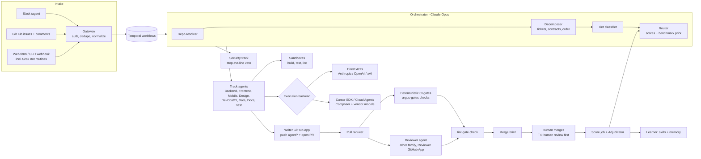

# Argus: Architecture v0.4

Status: draft for build.
Date: 2026-11-21. Supersedes v0.3 (v0.4 adds: Go as the system language, plain API calls with no AI frameworks, the stack template library, and the code-first rule).
Default branch: `master` for this system and for every repo created from the Argus templates. Onboarded repos keep their own default branch (read from the repo profile).

---

## 0. Instructions for the building AI (read first)

1. **Build phase by phase** (Section 22). Do not start Phase N+1 until Phase N acceptance criteria pass and a human signs off.
2. **Contracts are law.** The schemas in Section 5 are the interfaces between components. To change one, stop and ask the human with a short diff and the reason.
3. **Tests first.** Contract tests and unit tests before implementation. Every phase ships with green CI on `master`.
4. **No invention.** Model IDs, prices, vendor endpoints and benchmark numbers must come from vendor docs or the sources in Appendix A. Anything unverified is marked `TODO(verify)`. Model IDs live in `config/models.yaml`, never in code.
5. **Reuse before building.** Use standard tools (GitHub Actions, gitleaks, linters, test runners) for the gate checks instead of writing new ones; Argus code drives and reads them.
5a. **Go only, no AI frameworks.** The whole system is written in Go. Model calls are plain HTTPS calls to vendor APIs through thin in-house clients. Do not use LangChain, LangGraph, LlamaIndex or any other agent framework.
5b. **Code first, AI last.** If a job can be done by deterministic code, it must be. Call a model only for judgment that code cannot do (Section 10.3). Every model call site must be listed in `docs/model-calls.md` with its reason and token budget.
6. **Stack-agnostic core.** No language, framework or test runner hardcoded in core code. Stack details come from the repo profile and the template's stack options.
7. **Security rules are non-negotiable** (Section 17). No bot ever uses a human's PAT, password or SSH key.
8. **The referee is protected.** The central pipeline gates are built once and frozen; agents have no write access to them. Project CI is written only by the best model and reviewed by a human. Agents never edit CI to get a PR green (Sections 11.4 and 11.6).
9. **Token discipline.** Every prompt respects the context budgets in Section 6.2. Measure tokens per call in tests.
10. Ask before deleting data, rotating secrets, or touching any repo outside the sandbox allowlist. The building AI never pushes to any real org or client repo.

---

## 1. What this is

Argus is a self-hosted, open AI development pipeline. It replaces manual prompting of AI coding tools with a durable **Orchestrator** and a set of **track agents**, so that:

- Work comes in as GitHub issues or plain text (Slack, web form, CLI).
- AI decomposes it into small, provable tickets, assigns tiers and models, writes the code, the tests and the CI, reviews it with a model from a different family, and prepares the PR with a **merge brief**.
- The existing deterministic CI checks gate every PR.
- **Humans merge.** For Tiers 1 to 3 the review is done by AI only. For Tier 0 (project CI) and Tier 4 the review is done by AI and a human.
- Every merged change is scored, and scores decide **which model is used for what**.

It works for **new projects** (from the Argus stack templates) and **existing codebases** (onboarded by PR), across one repo or many repos in an org, for any stack the template supports or the repo already uses.

**Base model families:** Claude (Anthropic), GPT (OpenAI) and Grok (xAI). Within each family the router picks the right model for the tier (for example Haiku, Sonnet or Opus; Luna, Sol or Astra). Cursor's Composer is available through the Cursor execution backend (Section 16).

---

## 2. Key design decisions

| Topic | Decision |
|---|---|
| Pipeline CI (central gates) | **Built once, then frozen.** No agent can change it (Section 11.4) |
| Tier 0 (project CI, build, test config, scans, deploy config) | **Written only by the best model (Opus 5.5)**, reviewed by GPT-6 Astra + Grok red-team **and a human** |
| CI failures | **Code is assumed at fault.** CI is flagged only after the fault check and a cross-family review find the code correct; then a human checks CI following an AI diagnosis (Section 11.6) |
| Tier 4 | **AI writes it. Review by AI and a human** |
| Review on Tiers 1 to 3 | **AI only:** Reviewer model (different family) + deterministic gates |
| Who approves and merges | **Humans merge every PR**, guided by the AI merge brief. Human approval required at Tiers 0 and 4 (configurable, `policy.human_review_tiers`) |
| Decomposition (split, contract, sequence, tier) | **AI** (Planner); human sees the plan, and approves it at Tier 4 |
| Integration/E2E scenarios, QA acceptance | **AI-written**, reviewed like code; Tier 4 acceptance includes a human |
| Scoring purpose | **Routing only:** scores decide which model the agents use for each tier and kind of work. Automatic, within the allowlist and tier floor |
| Models | **Base families: Claude, GPT, Grok** (+ Composer via Cursor). Others can be added by config |
| Execution | **Coded orchestrator in Go** with two backends: direct vendor APIs, or Cursor Cloud Agents API. Plain API calls, no AI frameworks |
| Code vs AI | **Code first, AI last:** deterministic code does every job it can; models only for judgment (Section 10.3) |
| Templates | **Template library** of 9 stack templates with the same commands everywhere, created by the Go `argus init` command (Section 13) |

Also enforced in code: the anti-scope-creep rules (smallest diff, no new dependency without Tier 3, scope file list, two strikes then escalation, creativity is Tier 3, fail-before/pass-after test proof), the tier line caps (30 / 200 / 400), cross-family review, the hub communication model with the three-message cap and Security veto, the score file, no confidential client data to models, and no personal credentials for bots.

---

## 3. Principles and non-goals

### Principles
0. **Code first, AI last.** Deterministic code does everything it can: parsing, searching, validating, running, measuring, routing, formatting. Models are called only for judgment, and with the smallest context that works. This keeps cost down and results repeatable.
1. **Policy in config, enforcement in code.** Tiers, caps, allowlists and review rules live in `policy/`. Agents cannot change policy; only humans can.
2. **The pipeline is the referee.** Deterministic checks gate on exit codes. A model's opinion never overrides a failed check.
3. **No model reviews its own work.** Writer, Reviewer and Adjudicator are always different model families. The Orchestrator never scores.
4. **Small, provable tickets.** One outcome, one test, inside a line cap and a named file list. Tickets that grow are split, not expanded.
5. **Reuse before write.** Agents search the repo and org for existing code first and must justify new code (Section 10.2).
6. **Cheap context.** The Orchestrator builds one context packet per ticket. Track agents never get a repo dump.
7. **Durable and replayable.** Every run is a durable workflow; every model call and tool call is traced.
8. **Least privilege.** Each agent gets only the tools its contract lists, enforced in code. Writing and reviewing use separate GitHub identities.
9. **Provider-agnostic.** Vendors are adapters. Swapping a model is a config change.
10. **Humans hold the merge button.** No autonomous merge in v1.

### Non-goals (v1)
- Training or fine-tuning models.
- Autonomous merges or autonomous production deploys.
- Production data access of any kind.
- Replacing GitHub, CI or Cursor. The system drives them.
- Multi-tenant SaaS. One deployment per company; every table carries `org_id` so this is possible later.
- Git hosts other than GitHub.

---

## 4. System overview



### Components

| # | Component | Responsibility |
|---|---|---|
| 1 | Gateway / Intake | Receive events, verify signatures, dedupe, normalize into a `Ticket` |
| 2 | Workflow engine | Durable runs, retries, timers, waiting for humans |
| 3 | Orchestrator | Resolve repos, decompose, tier, route, dispatch, track the run |
| 4 | Track agents | Do the work for one discipline as Writer or Reviewer |
| 5 | Security track | Security review on every Tier 2+ PR; can halt any run |
| 6 | Model Gateway | One interface to Claude, GPT, Grok; budgets, fallbacks, caching, token accounting |
| 7 | Execution backends | Local agent loop on direct APIs, or Cursor SDK / Cloud Agents |
| 8 | Tool layer | Sandboxes, git, build/test, GitHub Apps |
| 9 | Gates | Existing CI checks + `tier-gate` status check |
| 10 | Merge brief | AI-written instructions for the human who merges |
| 11 | Scoring and routing | Score file, Adjudicator, model choice per tier and work type |
| 12 | Onboarding and projects | Existing-repo onboarding PRs; new projects from the template |
| 13 | Memory and skills | Project facts, team conventions, reusable skills |
| 14 | Observability | Traces, cost and quality dashboards |

---

## 5. Core contracts

All messages are JSON. Contracts are Go structs in `internal/contracts/`; JSON Schemas are generated from them into `contracts/schema/` and checked in, and every message is validated against its schema at each boundary (including model outputs, which are rejected and retried once if invalid). Every object carries `schema_version` and `org_id`.

### 5.1 Ticket (output of Intake)
```json
{
  "schema_version": "3",
  "org_id": "org_acme",
  "ticket_id": "TKT-2026-000123",
  "source": "github|slack|webhook|form|cli",
  "source_ref": "acme/fleet-api#412",
  "kind": "request|bug|incident|project",
  "mode": "existing|new_project",
  "title": "string",
  "body": "string (normalized markdown)",
  "repo_hint": "acme/fleet-api|null",
  "requester": { "user_id": "u_17", "display": "string" },
  "attachments": [ { "uri": "s3://...", "mime": "image/png" } ],
  "created_at": "2026-11-20T13:20:00Z"
}
```

### 5.2 WorkTicket (output of the Decomposer: one small, provable unit)
One request usually becomes several WorkTickets.
```json
{
  "schema_version": "3",
  "work_id": "TKT-123.4",
  "parent_ticket": "TKT-2026-000123",
  "repo": "acme/fleet-api",
  "track": "backend|frontend|mobile|design|devops|data|docs|test|security",
  "tier": 2,
  "tier_reasons": ["new endpoint", "touches 3 files"],
  "outcome": "One sentence: what is true when this is done",
  "contract": "Interface note: inputs, outputs, failure case",
  "scope_files": ["src/orders/notes.py", "src/orders/routes.py", "tests/orders/test_notes.py"],
  "line_cap": 200,
  "proof_test": "tests/orders/test_notes.py::test_owner_can_add_note",
  "depends_on": ["TKT-123.3"],
  "new_dependencies_allowed": false,
  "acceptance_criteria": ["..."],
  "split": "vertical|horizontal"
}
```
Rules enforced at creation: describable in a short paragraph, provable by one test, `scope_files` non-empty, `line_cap` = tier cap, no two parallel WorkTickets share a file.

### 5.3 Plan
```json
{
  "schema_version": "3",
  "ticket_id": "TKT-2026-000123",
  "targets": [ { "repo": "acme/fleet-api", "reason": "...", "confidence": 0.93 } ],
  "work_tickets": ["TKT-123.1", "TKT-123.2", "TKT-123.3"],
  "order": [["TKT-123.1"], ["TKT-123.2", "TKT-123.3"]],
  "max_tier": 2,
  "change_set_id": "cs_...|null",
  "needs_human_plan_approval": false,
  "budget": { "max_usd": 6.0 }
}
```
`needs_human_plan_approval` is true when any WorkTicket is Tier 4 or the request is a new project.

### 5.4 TaskEnvelope (Orchestrator to track agent)
```json
{
  "schema_version": "3",
  "run_id": "run_...",
  "work_id": "TKT-123.4",
  "role": "writer|reviewer",
  "track": "backend",
  "tier": 2,
  "attempt": 1,
  "model": { "ref": "anthropic:claude-sonnet-5.5", "backend": "api|cursor", "fallbacks": ["openai:gpt-6.1-sol"] },
  "context_packet": {
    "outcome": "...",
    "contract": "...",
    "acceptance_criteria": ["..."],
    "scope_files": ["..."],
    "line_cap": 200,
    "proof_test": "...",
    "rules_refs": ["org:AGENTS.md@<sha>", "repo:AGENTS.md@<sha>"],
    "file_summaries": [ { "path": "src/orders/routes.py", "summary": "..." } ],
    "reuse_candidates": [ { "repo": "...", "symbol": "...", "path": "...", "why": "..." } ],
    "prior_attempts": [ { "attempt": 1, "model": "...", "failure": "..." } ],
    "skills": [ { "skill_id": "api-error-format", "version": 3 } ],
    "memory_snippets": ["..."]
  },
  "workspace": { "sandbox_id": "sbx_...", "base": "master", "branch": "agent/TKT-123.4-order-notes" },
  "permissions": ["fs.rw:/work", "shell", "git.local", "tests.run", "index.search"],
  "budget": { "max_usd": 1.50, "max_tokens": 200000, "max_minutes": 20 }
}
```

### 5.5 WriterResult
```json
{
  "schema_version": "3",
  "run_id": "run_...",
  "work_id": "TKT-123.4",
  "status": "done|failed|grew_too_big|needs_input|env_broken|budget_exceeded",
  "summary": "<= 300 tokens",
  "diff_uri": "sbx://sbx_123/patch.diff",
  "files_changed": ["..."],
  "lines_changed": 64,
  "commit_shas": ["abc123"],
  "proof": { "fails_on_parent": true, "passes_on_change": true },
  "self_check": { "build_ok": true, "tests_passed": 41, "tests_failed": 0, "lint_clean": true },
  "reuse_decisions": [ { "candidate": "...", "decision": "reused|not_reused", "reason": "..." } ],
  "new_dependencies": [],
  "grew_report": "null | what was found and a proposed split",
  "usage": { "input_tokens": 0, "output_tokens": 0, "usd": 0.0, "wall_seconds": 0 },
  "learned_candidates": ["..."]
}
```
`grew_too_big` is not a failure against the Writer. The Decomposer re-splits.

### 5.6 ReviewReport (Reviewer agent, different family from the Writer)
```json
{
  "schema_version": "3",
  "work_id": "TKT-123.4",
  "pr": "acme/fleet-api#88",
  "reviewer_model": "openai:gpt-6.1-sol",
  "writer_model": "anthropic:claude-sonnet-5.5",
  "verdict": "pass|changes_required|block",
  "findings": [
    { "id": "F1", "severity": "blocking|major|minor|nit", "file": "...", "line": 42, "rule": "scope|smallest-diff|security|correctness|reuse|style", "text": "..." }
  ],
  "checklist": { "in_scope": true, "smallest_diff": true, "test_proves_change": true, "no_new_deps": true, "reuse_ok": true, "security_ok": true }
}
```

### 5.7 GateResult (`tier-gate` status check)
```json
{
  "schema_version": "3",
  "pr": "...",
  "tier": 2,
  "ci_checks": { "scope": "pass", "line_cap": "pass", "lint_tests": "pass", "test_proof": "pass", "gitleaks": "pass", "dep_audit": "pass", "dup_check": "pass" },
  "ai_review": "pass",
  "security_review": "pass|not_required",
  "human_review": "approved|pending|not_required",
  "state": "ready_to_merge|blocked",
  "blocked_reasons": []
}
```

### 5.8 MergeBrief (posted on the PR when the gate is green)
```json
{
  "schema_version": "3",
  "pr": "...",
  "tier": 2,
  "one_line": "Adds owner-only notes to orders (PATCH /orders/{id}/note)",
  "what_changed": ["..."],
  "evidence": ["test proof: fails on parent, passes on change", "41/41 tests", "review: 0 blocking, 1 minor fixed"],
  "risk": "low|medium|high",
  "risk_notes": ["new nullable column; migration is reversible"],
  "merge_instructions": ["Merge after fleet-api#87", "Use squash merge"],
  "after_merge": ["Run migration 0042 on staging before deploy"],
  "rollback": "Revert this PR; migration 0042 has a down step",
  "human_checks_tier4": []
}
```

### 5.9 ScoreRecord (one line per merged PR, appended to the score file)
```json
{"schema_version":"3","ts":"2026-11-20T13:51:00Z","org":"org_acme","ticket":"TKT-123.4",
 "repo":"acme/fleet-api","track":"backend","tier":2,"work_type":"feature",
 "writer":"anthropic:claude-sonnet-5.5","backend":"api","reviewer":"openai:gpt-6.1-sol",
 "adjudicator":"xai:grok-4.7","attempts":1,"files_changed":3,"lines_changed":64,
 "scope_pass":true,"test_proof_pass":true,"findings":{"accepted":1,"rejected":0},
 "input_tokens":182000,"output_tokens":21000,"usd":0.57,"duration_s":540,
 "dims":{"first_pass":1.0,"scope":1.0,"test_proof":1.0,"cost_speed":0.72,"review_survival":0.9},
 "total":0.94,"reverted_within_14d":null}
```

### 5.10 Other contracts
`RepoProfile`, `OrgMap`, `ChangeSet` and `ProjectSpec` are carried over from v0.2 unchanged in shape (see `packages/contracts/`), with `default_branch` defaulting to `master` for template-created repos.

---

## 6. Orchestrator

The Orchestrator is an agent (Claude Opus 5.5 by default) wrapped in deterministic code. Code owns state, policy, budgets, retries and routing math. The model owns judgment: understanding requests, finding the right repo, decomposing work. The Orchestrator assigns work and never scores it.

### 6.1 Repo resolver
Finds which repo(s) a request touches using the org map, code index and `repo_hint`. If the top confidence is below 0.7 it asks the requester instead of guessing. Cross-repo work becomes a `ChangeSet` with merge order (providers before consumers).

### 6.2 Decomposer
Implements the decomposition ladder in code:
1. Split by outcome (vertical slices by default; horizontal only for truly independent pieces).
2. Write the contract (interface, inputs, outputs, failure case) before any code.
3. Sequence: each WorkTicket depends only on merged work.
4. Assign tier and line cap per WorkTicket.
5. Name `scope_files` and one `proof_test` per WorkTicket.

Checks before dispatch: every WorkTicket passes the threshold rule (short paragraph, one test); parallel tickets share no file; a ticket that can't name its scope files is not ready. The plan is posted to the issue or Slack thread so people can see it. Tier 4 plans and new projects wait for human approval.

Context budgets per Writer call: ticket packet ≤ 6k tokens, skills ≤ 3k, memory ≤ 1.5k, reuse candidates ≤ 1.5k.

### 6.3 Tier classifier
Rules first (`policy/tiers.yaml`), then a cheap model; take the higher tier.
- Path and keyword rules: auth, permissions, payments, secrets, migrations on live data, concurrency → Tier 3+; security boundaries and incident fixes → Tier 4; project CI/build/deploy config → Tier 0; docs-only, renames, simple validation → Tier 1.
- Requests that would change central gate workflows or `policy/` are refused and routed to a human (Section 11.4).
- A WorkTicket that needs a new dependency → Tier 3.
- Humans can override with `/tier N`; overrides are logged.

### 6.4 Router
Picks the Writer model, Reviewer model and Adjudicator per WorkTicket. Section 9.

### 6.5 Control loop
```
plan = Decomposer(Resolver(ticket))
if plan.needs_human_plan_approval: wait_for_signal("plan_approved")
for batch in plan.order:                       # tickets in a batch run in parallel
  for wt in batch (parallel):
    writer = Router.writer(wt); attempt = 1
    loop:
      res = run_writer(wt, writer, attempt)
      if res.status == "grew_too_big": Decomposer.resplit(wt, res.grew_report); break
      if res.status == "env_broken": mark_profile_broken(wt.repo); notify_owner(); halt(wt)
      pr = GitOps.open_or_update_pr(wt, res)
      wait_for(ci_checks(pr))
      if ci_green(pr):                          # no model review of code that fails deterministic checks
          review = run_reviewer(wt, pr, Router.reviewer(wt, writer))
          if wt.tier >= 2: security = run_security(wt, pr)
      if gate_green(pr): break
      # CI failures are treated as code faults first (Section 11.6). The Writer may never edit CI files in a code ticket.
      if ci_failed(pr) and attempt == 2:
          t = fault_check(wt, pr)                 # evidence + cross-family review of the code
          if t == "flaky": rerun_ci_once(pr); continue
          if t == "ci_suspect": flag_ci(pr); wait_for_signal("ci_resolved", pr); attempt = 1; continue
          # t == "code_fault": fall through to normal escalation
      if attempt == 2: writer = Router.escalate(wt, writer); wt.tier = min(wt.tier+1, 4); attempt = 0   # two strikes
      if escalations(wt) > 1: notify_human(); halt(wt)
      attempt += 1                              # Writer revises with findings attached
    post_merge_brief(pr)
    if wt.tier in policy.human_review_tiers: wait_for_signal("human_approved", pr)
    wait_for_signal("merged", pr)               # a human merges
    score_job(pr); Learner.after_merge(pr)
```

---

## 7. Agents

### 7.1 Tracks and functions
Agents are organised by **track** (discipline), and each track can act in two **functions**: Writer or Reviewer. Writer and Reviewer on the same WorkTicket always use different model families.

| Track | Works on | Default tools |
|---|---|---|
| Backend | APIs, services, business logic, DB access | fs.rw (scope), shell, tests.run, index.search |
| Frontend | Web UI, components, client API calls | same + browser.sandboxed |
| Mobile | Flutter, React Native, Swift, Kotlin apps | same + mobile build tools in sandbox |
| Design | UI specs, design tokens, Figma reading (read-only) | figma.read, fs.rw (design docs) |
| DevOps/CI | CI workflows, Dockerfiles, deploy config, Dependabot | fs.rw (CI and infra paths), shell, actionlint |
| Data | Schemas, migrations, queries, performance | fs.rw (scope), shell, db.test |
| Test | Unit, integration and E2E tests and scenarios | fs.rw (test paths), shell, tests.run, browser.sandboxed |
| Docs | READMEs, docs, changelogs, `docs/overview.md` | fs.rw (doc paths) |
| Security | Security review, threat notes, secret and dependency findings | repo.read, diff.read, scanners; veto |

Plus three non-track agents:
- **Orchestrator** (Section 6).
- **Adjudicator**: scores review survival after merge. Always a different family from the Writer, and never the Orchestrator's model.
- **Learner**: turns repeated lessons into skills and memory (Section 15).

### 7.2 Communication (hub model)
- All handoffs go through the Orchestrator. Allowed direct links: Backend ↔ Frontend (interface and contract questions), Frontend ↔ Design, Mobile ↔ Backend.
- A topic between two tracks is capped at **three messages**; then it returns to the Orchestrator, which decides or escalates to a human.
- Only the Orchestrator sends messages to Security. **Security can stop any run** (one-way veto). A veto blocks the `tier-gate` check until resolved.
- All messages are stored on the run, so every decision has one record.

### 7.3 Role files
Each track is a folder `packages/agents/tracks/<track>/` with `writer.md` and `reviewer.md` (system prompts, under 120 lines each), `contract.py`, `tools.yaml` (allowlist, enforced in code) and `evals/` (golden tasks across at least 3 stacks).

---

## 8. Tiers and review

| Tier | Kind of work | Writer (primary / alternates) | Reviewer (other family) | Line cap | Human |
|---|---|---|---|---|---|
| **0 Project CI** | The project's own CI workflows, build, lint and test config, scan config, deploy config, Dependabot (never the central pipeline gates, which are frozen) | **Opus 5.5 only** (best available model; no cheaper alternates) | GPT-6 Astra + Grok 4.7 red-team | 200 | **Reviews and approves**, then merges |
| **1 Routine** | CRUD, validation, renames, docs, unit tests on existing code, known one-line fixes | Haiku 5.5 / Composer 2.5 / GPT-6 Luna | GPT-6 Luna / Grok 4.6 / Haiku 5.5 | 30 | Merges only |
| **2 Feature** | Multi-file feature, refactor, API integration, SQL tuning, integration tests | Sonnet 5.5 / GPT-6.1 Sol / Grok 4.6 | GPT-6.1 Sol / Sonnet 5.5 + Security track | 200 | Merges only |
| **3 Design** | Architecture, schema design, auth and permissions, live-data migrations, payments, concurrency, new dependencies | Opus 5.5 / GPT-6 Astra | GPT-6 Astra / Opus 5.5 + Grok 4.7 red-team + Security track | 400 + ADR | Merges only |
| **4 Critical** | Security boundaries, incident fixes, production-impacting changes | Opus 5.5 / GPT-6 Astra | GPT-6 Astra / Opus 5.5 + Grok 4.7 red-team + Security track **+ human reviewer** | 400 + ADR | **Reviews and approves**, then merges |

Model names in this table are the starting point from public benchmarks (Section 9 and Appendix A); the router changes them as scores build up. All IDs `TODO(verify)` against vendor docs.

Rules:
- The `tier-gate` check is green only when every CI check passes, the AI review is `pass`, Security (Tier 2+) has no veto, and, for tiers in `policy.human_review_tiers` (default `[0, 4]`), a human has approved.
- `policy.human_review_tiers` is config, so adding Tier 3 later needs no code change.
- Tier 0 Writer is pinned to the best model in the allowlist (`policy/allowlist.yaml: tier0.writer`); the router does not explore or cost-optimize at Tier 0.
- CI files are never in `scope_files` of a Tier 1–4 ticket, so the existing scope check blocks any code PR that touches CI.
- The central pipeline gates are not a tier at all: agents cannot change them (Section 11.4).
- Tier 4 also requires human approval of the **plan** before work starts. Business decisions are never taken by AI: for those, agents draft options and stop.
- Incidents: agents can investigate read-only and propose a fix PR (Tier 4). Production access, deploys and rollbacks are done by humans.

---

## 9. Models and routing

### 9.1 Families
| Family | Models in use | Role in the system |
|---|---|---|
| Claude (Anthropic) | Opus 5.5, Sonnet 5.5, Haiku 5.5 | Orchestrator; only Writer at Tier 0; main Writer at Tiers 2, 3, 4; cheap Writer at Tier 1 |
| GPT (OpenAI) | GPT-6 Astra, GPT-6.1 Sol, GPT-6 Luna | Main Reviewer for Claude-written code; alternate Writer |
| Grok (xAI) | Grok 4.7, Grok 4.6 | Red-team reviewer at Tiers 3–4; Adjudicator; alternate Writer/Reviewer at Tiers 1–2 |
| Composer (Cursor) | Composer 2.5 | Cheap Writer at Tier 1, only through the Cursor backend (no public API) |

Optional by config: Claude Fable 5.2 (stronger, much more expensive) for Tier 4 Writer; Google, DeepSeek or other providers through new adapters.

### 9.2 Starting point from public benchmarks (Nov 2026)
Benchmarks differ in harness and effort setting, so they only set the **starting order**. Your own scores take over as they accumulate.

| Model | List price in/out per 1M | Terminal-Bench 4.0 | Terminal-Bench 2.1 ext. | Agentic Coding 2.0 | Notes |
|---|---|---|---|---|---|
| Claude Opus 5.5 | $4 / $20 | 64.8% | 47.5% | 40.4% | Top on Terminal-Bench 4.0 and Senior SWE-bench |
| Claude Sonnet 5.5 | $2 / $10 | 61.8% | 45.5% | – | Near Opus at half the price |
| Claude Haiku 5.5 | $0.10 / $0.50 | – | 37.7% | – | Very cheap; good enough for routine work |
| GPT-6 Astra | $10 / $50 | 58.2% | – | 47.6% | Top on Agentic Coding 2.0; expensive |
| GPT-6.1 Sol | $2 / $10 `TODO(verify)` | – | 45.8% | 42.8% | Close to Astra at a fraction of the cost |
| GPT-6 Luna | $0.10 / $0.50 | – | – | – | Cheapest GPT; weak on hard agentic tasks |
| Grok 4.7 | $2 / $6 | 37.6% | – | 31.9% | Behind Claude/GPT; uses many output tokens per task |
| Grok 4.6 | $2 / $6 | – | 45.5% | 33.6% | Often cheaper per task than 4.7 |
| Composer 2.5 | $0.50 / $2.50 (Cursor) | – | – | – | Cursor-only; strong for its price on Cursor's own benchmarks |

Sources in Appendix A. Re-check prices and IDs in each phase.

### 9.3 Routing rules
1. **Eligible set** = models allowed for `(tier, function)` in `policy/allowlist.yaml`. Never below the tier floor.
2. **Cross-family:** Reviewer family ≠ Writer family; Adjudicator family ≠ Writer family; Adjudicator ≠ Orchestrator model.
3. **Score:** for each eligible model, per bucket `(tier, track_group, function)` where `track_group` is one of `code`, `ui`, `pipeline`, `data`, `docs_tests`, the router keeps the rolling average of the last 30 merged scores window and the mean cost per merged ticket.
4. **Benchmark prior:** each model starts with a prior from Section 9.2 worth 10 merges. Real results replace it as merges accrue, so the first weeks follow benchmarks and later weeks follow your own results.
5. **Pick:** highest expected value of `score − λ·cost` (λ in `config/routing.yaml`, per tier; λ = 0 at Tier 4, so cost is ignored there). Up to 10% exploration at Tiers 1–2 (try an alternate), none at Tiers 0, 3 and 4. Tier 0 always uses the pinned best model.
6. **Escalation:** two failed attempts → next model up the tier ladder and tier +1, with both attempts attached.
7. **Health:** a provider with errors above threshold in the last 15 minutes is skipped; fallback stays in the same tier floor and keeps the cross-family rule.
8. Every routing decision is logged with the numbers behind it. A weekly routing report goes to Slack.

---

## 10. Rules enforced in code

### 10.1 Anti-scope-creep
| Rule | Enforcement |
|---|---|
| Smallest diff wins | Line cap check in CI; Reviewer checklist item `smallest_diff`; Writer prompt; new helpers/wrappers/flags in a bug fix are a blocking finding |
| No new dependencies without Tier 3 | Manifest diff check in CI; any new dependency on a WorkTicket below Tier 3 fails |
| Nothing outside named scope | Existing scope check in CI against `scope_files` (written to the PR template by GitOps) |
| Two strikes, then escalation | Control loop (Section 6.5) |
| Creativity is Tier 3 | Reviewer flags redesigns in Tier 1–2 tickets as blocking |
| Fail-before / pass-after test | Existing test-proof check in CI |

### 10.2 Reuse and no duplicated code
- The Decomposer adds `reuse_candidates` from the repo and org code index to each WorkTicket.
- The Writer returns a `reuse_decisions` entry for each candidate.
- A duplication check (jscpd or equivalent per stack, `TODO(verify)`) runs in CI; new clone blocks above threshold fail. New public functions very similar to existing ones (embedding similarity > 0.9) without a `not_reused` reason are a blocking review finding.
- Org, stack and repo `AGENTS.md` rules are loaded in that order for every agent.
This reduces new duplication and style drift sharply; it cannot promise zero, and the duplication rate is tracked per repo.

### 10.3 Code first, AI last (where models are and are not used)

| Job | Done by code | Model used only for |
|---|---|---|
| Intake: parse, authenticate, dedupe, commands (`/tier`, `/ci-ok`, ...) | All | – |
| Filling the request template | Extract fields that are already structured (labels, repo, links, files) | Missing free-text fields and clarifying questions (cheap model) |
| Repo resolution | `repo_hint`, path/symbol/full-text search, org map edges | Ranking when the top two candidates are close (cheap model) |
| Tier | Path, keyword and file-count rules | Only when rules return `unknown` (cheap model) |
| Decomposition | Validating scope files exist, line caps, no shared files across parallel tickets, ordering (topological sort) | Splitting the request into WorkTickets (Opus) |
| Context packet | Assembly, token budgeting, file summaries cached by file hash | Summaries for new or changed files only (cheap model, cached) |
| Onboarding an existing repo | Parsing CI files, manifests, devcontainer, CODEOWNERS; running build/test/lint | Short `docs/overview.md` prose |
| New project setup | `argus init` creates the repo from templates; template repos ship a ready `RepoProfile`, so no AI onboarding | Drafting the ProjectSpec |
| Build, test, lint, scans | All (sandbox and CI) | – |
| Test failures fed back to the Writer | Parsers (JUnit XML, `go test -json`, pytest, Jest/Vitest, Flutter, Gradle, XCTest) extract only failing tests and the relevant stack lines | – |
| Scope, line caps, test proof, secrets, new dependencies, duplication | CI gates | – |
| Code review | Runs only after CI is green; reviewer gets the diff plus static-analysis output, not whole files | Judging correctness, design and security (cross-family) |
| CI fault check | Rerun, base-branch run, sandbox reproduction | One question: is the code correct? |
| PR description and merge brief | Filled from data (tickets, checks, diff stats, findings) by templates | One-line summary and risk notes (cheap model) |
| Scoring | First-pass, scope, test proof, cost/speed; review survival matched by code (finding → later commit touching those lines → reviewer re-check) | Disputed findings only (Adjudicator, cheap model) |
| Routing, budgets, retries, fallbacks | All | – |
| Learner | Clustering findings by embeddings and counting repeats | Writing the skill text |

Other token rules: review diffs, not files; stable prompt prefixes for provider caching; tool outputs truncated with a pointer to the full log; stop at the first failed deterministic check instead of asking a model; never send a model anything code has already decided.

---

## 11. Gates in GitHub

### 11.1 Identities (separation of duties)
| GitHub App | Can do | Cannot do |
|---|---|---|
| `argus-writer` | Push to `agent/*` branches, open and update PRs, comment | Review, approve, merge, push to default branch |
| `argus-reviewer` | Submit reviews and the `ai-review` / `security-review` check runs | Push code, merge |
| `argus-gate` | Post the `tier-gate` check run and the merge brief | Push code, approve, merge |
| `argus-scorer` | Commit the score file on merge (bypass for that path only) | Anything else |

Installation tokens are short-lived (1 hour), minted by the Tool layer, never visible to a model.

### 11.2 Branch protection / rulesets on every connected repo
- Required status checks: the existing CI checks + `tier-gate`.
- No required human review in GitHub settings (the `tier-gate` check enforces human approval for Tier 4 itself, by checking for an approving review from a member of the `tier4-reviewers` team).
- Only humans can merge (no app has merge permission). No direct pushes to the default branch.
- `CODEOWNERS` kept for notification; ownership of Tier 4 areas is listed in `policy/owners.yaml`.

### 11.3 The merge brief
When `tier-gate` turns green, `argus-gate` posts the MergeBrief (Section 5.8) as a PR comment and Slack message: what changed, evidence, risk, merge order, post-merge steps, rollback. The human follows it and clicks merge. For Tier 4, the brief also lists what the human reviewer must check, and the gate stays red until they approve.

### 11.4 Two kinds of CI

There are two layers of CI, with different rules.

**Pipeline CI (the central gates): built once, then frozen.**
- The gate workflows (scope check, line caps, test proof, lint/test runner, gitleaks, dependency audit, duplication check, AI review reporter, `tier-gate`, score job) live in `argus-gates` and every repo calls them at a pinned version (reusable workflows or org-level required workflows `TODO(verify)` against the org's GitHub plan).
- They are built once, in Phase 1, and accepted when the **gate test suite** passes: a fixed set of known-bad PR fixtures (file outside scope, diff over each line cap, test that does not fail on the parent, leaked secret, new dependency below Tier 3, duplicated block, a code PR that touches CI files). Every fixture must fail the gates.
- After acceptance the gates are **frozen**. No agent has write access to the gate workflows or to `policy/`; the Writer App's installation excludes those paths and the ruleset blocks them. There is no tier for changing them.
- If a change is ever unavoidable (for example a GitHub Actions deprecation), it is a manual human change outside the agent system, and the gate test suite must pass again before repos move to the new pinned version.

**Project CI (each repo's own workflows): critical, best model plus human review.**
- Build steps, test matrix, caching, lint configuration, deploy workflows, Dockerfiles, Dependabot: everything a repo needs beyond the central gates.
- This is Tier 0. Only the best model in the allowlist writes it (Opus 5.5 today). GPT-6 Astra reviews it with a Grok red-team, and a **human reviews and approves** before merging.
- A Tier 0 PR contains CI changes only, never product code. Product-code tickets never include CI files in their scope, so the scope check blocks them automatically.
- Project CI can add steps but cannot remove or bypass the call to the central gates; a PR that does is blocked by the `tier-gate` check.

### 11.5 One AI review, not two
The gates include an "AI review" CI step. That step does not call its own model: it reads the Reviewer agent's `ReviewReport` for the PR and passes or fails on its verdict. This keeps a single reviewer, chosen by the router, always from a different family than the Writer, and scored once.

### 11.6 When CI fails: code first, then flag CI
Agents assume a CI failure is a problem in the code, never in CI, and they are not allowed to edit CI to get a PR green.

1. **Fix the code.** The Writer gets the failing check, a truncated log and a pointer to the full log, and fixes the code. These attempts count under the normal two-strikes rule.
2. **Fault check after two failed attempts on the same check.** Before escalating, the Orchestrator runs `fault_check`:
   - **Evidence (deterministic):** rerun the failed job once (flakiness); run the same check on the base branch with no changes (is CI already broken?); reproduce the check in the sandbox with the same command; check whether the failure is in files the PR changed or in CI infrastructure (runner, network, cache, secrets, tool versions).
   - **Code review:** a Reviewer from a different family than the Writer reads the code, the acceptance criteria, the failing test and the evidence, and answers one question: is the code correct?
3. **Outcome:**
   - `flaky`: the rerun passes. Note it, continue, and count flaky checks per repo on the dashboard.
   - `code_fault`: the base branch passes or the reviewer finds a code problem. Back to the normal loop: escalate the Writer and attach the evidence.
   - `ci_suspect`: the base branch also fails the same way, or the reviewer confirms the code is correct and the failure sits in CI or its environment. The PR is **flagged**.
4. **Flagging CI.** The PR gets the label `ci-suspect`, the ticket pauses, and the system posts a **CI diagnosis** for a human on the PR and in Slack: which check failed, the evidence above, the suspected cause (file and line in the workflow, or the environment), what the human should check step by step, and a proposed fix.
5. **Human decision.**
   - CI is at fault: the human fixes it following the guide, or approves a Tier 0 ticket for Opus to write the fix (human review as usual). Then the paused ticket resumes.
   - The code is at fault after all: the human says so with `/ci-ok <reason>`; the ticket goes back to the Writer with that note, and the case is fed to the Learner.
6. **Scoring.** Attempts lost to a confirmed CI fault don't count against the Writer's score. A `ci_suspect` flag that turns out to be a code fault counts against the Reviewer that cleared the code.

### 11.7 Gate workflows are not duplicated
The system never re-implements a check that the pipeline CI runs. It reads check results from GitHub and acts on them.


---

## 12. Existing repos: onboarding

Automated steps:
1. Repo is transferred into (or already lives in) the org and added to the GitHub Apps' installation.
2. **Discover** (Learner, Opus): CI files, devcontainer/Dockerfile, manifests, README, CODEOWNERS, existing agent rule files. Draft a `RepoProfile`: build/test/lint commands, services, areas, sensitive paths, default branch, test strength.
3. **Verify in a sandbox:** build, run tests and lint on the default branch; record the baseline and known failures. If it can't build, report exactly what is missing (private registry, services, secrets) and stop.
4. **Secrets:** run a full-history gitleaks scan; anything found is reported for rotation (humans rotate).
5. **Onboarding PR** (Tier 0: Opus writes, AI and human review, human merges): `docs/overview.md` (map of the repo), repo `AGENTS.md`, PR template with scope list, project CI calling the central gate workflows, lint kept lenient at first.
6. **Tests before refactors:** if test strength is weak, the first WorkTickets the system proposes are characterization tests, before any refactor.
7. Index the repo (symbols, summaries, embeddings) and add it to the org map.
8. **Pilot first:** one repo is onboarded and proven before others (enforced as an org setting).

---

## 13. New projects and the stack template library

### 13.1 Template library (`argus-templates`)
Every new project starts from a tested template. Templates are written and kept up to date as code, so agents never spend tokens on setup.

| Area | Template id | Stack and tools (versions pinned, `TODO(verify)` at build time) |
|---|---|---|
| Backend | `be-fastapi` | Python, FastAPI, uv, SQLAlchemy 2 + Alembic, ruff, mypy, pytest |
| Backend | `be-node-ts` | Node.js LTS, TypeScript, NestJS, pnpm, Prisma, eslint + prettier, Jest |
| Backend | `be-go` | Go, chi, pgx + sqlc, golangci-lint, go test, govulncheck |
| Frontend | `fe-next` | Next.js (App Router), TypeScript, pnpm, eslint + prettier, Vitest + Testing Library, Playwright |
| Frontend | `fe-vue` | Vue 3 + Vite, TypeScript, Pinia, Vue Router, eslint + prettier, Vitest, Playwright (Nuxt variant later) |
| Mobile | `mob-flutter` | Flutter stable, dart analyze, flutter test, integration_test |
| Mobile | `mob-react-native` | React Native with Expo, TypeScript, eslint, Jest + RN Testing Library |
| Mobile | `mob-ios-swift` | Swift, SwiftUI, Swift Package Manager, SwiftLint, swift-format, XCTest |
| Mobile | `mob-android` | Android, Gradle, Kotlin by default with a Java option, ktlint/detekt (Checkstyle for Java), JUnit, Espresso |

Every template contains the same pieces, so agents and the pipeline work the same way in every stack:
- **The same commands everywhere** through a `Makefile` (or Taskfile): `make setup`, `make build`, `make test`, `make test-one T=<test>`, `make lint`, `make fmt`, `make run`. The pipeline only ever calls these verbs.
- A ready `.argus/profile.yaml` (`RepoProfile`), so new repos need no AI onboarding.
- Devcontainer and Dockerfile (except iOS), project CI that calls the central gates, Dependabot, gitleaks config.
- `AGENTS.md` with the stack rules, `docs/overview.md`, PR template with the scope list, CODEOWNERS placeholder, `.env.example`.
- One small sample feature with tests, written in the house style, so agents copy the right patterns.
- A health check endpoint or screen, and a passing test suite on day one.

Templates are tested by their own CI: each template is generated with `argus init`, then `make setup build lint test` must pass. Templates are versioned; the template version is recorded in each repo's profile. Changing a template is Tier 0 (best model writes, human reviews).

**Mobile build note:** iOS (and macOS-only tooling) cannot build in Linux containers. iOS work runs on macOS CI runners or a self-hosted Mac build host; agents get feedback from those runs, which is slower and costs more. Android, Flutter and React Native build in Linux containers (Android emulator tests run in CI only).

### 13.2 `argus init`
A Go command that composes one or more templates into a new repo with no model calls:
`argus init --name field-inspections --layout monorepo --stacks be-go,fe-next,mob-flutter --sector <sector>`
It copies the templates, fills names, wires the components (API base URLs, shared env, one root `Makefile` that runs each component's verbs), writes the profile, and produces the bootstrap commit. Multi-repo layouts create one repo per component.

### 13.3 New project flow
1. **Discovery:** the Orchestrator asks the requester the missing questions (users, features, platforms, scale, languages incl. Arabic/RTL, integrations, deadline) and writes the PRD to the config repo.
2. **Spec (Tier 4 plan):** Opus drafts a `ProjectSpec`: templates chosen from the library (one per component), layout, integrations with existing org repos, milestones (milestone 1 is always a walking skeleton), budget. GPT-6 Astra and Grok 4.7 critique it. A human approves.
3. **Repo creation:** a human creates the empty repo(s) with default branch `master` and adds them to the Apps. (Optional later: a separate repo-creator App.)
4. **Init:** `argus init` generates the code from the templates; GitOps opens the bootstrap PR (Tier 0: human reviews). The profile ships with the template, so it is verified by running `make setup build lint test`.
5. **Protection:** the system checks branch protection, secrets and rulesets; if missing, it posts the exact settings for a human to apply.
6. **Backlog:** each milestone is decomposed into WorkTickets, created as GitHub issues, and run through the normal pipeline. At each milestone end, a demo report (what was built, evidence, preview link, cost) goes to the requester before the next milestone starts.

---

## 14. Scoring (for routing)

Scoring has one job: tell the router which model to use for which tier and kind of work.

- **Five dimensions**, computed after each merge:

| Dimension | Weight | Source |
|---|---|---|
| First-pass correctness | 30% | Pipeline: green CI on first attempt; each retry lowers it |
| Scope discipline | 25% | Pipeline: files changed vs `scope_files` |
| Test proof | 20% | Pipeline: fail-before / pass-after |
| Cost and speed | 10% | Pipeline: tokens, USD and duration vs tier median (now real numbers from the Model Gateway or Cursor usage API) |
| Review survival | 15% | Adjudicator: reviewer findings and whether they were fixed or dismissed |

- **Revert signal:** if the PR is reverted within 14 days, the record is updated and the score for that merge is set to 0.
- **Storage:** the score file in each repo (append-only, committed by the pipeline identity, as today) plus Postgres for fast routing queries. Postgres is rebuilt from score files if needed, so the files stay the source of truth.
- **Use:** rolling 30-merge average per `(model, tier, track_group, function)`, combined with the benchmark prior (Section 9.3).
- **No consequences beyond routing:** a model with poor scores simply stops being picked. Removing a model from the allowlist is a human policy change.

---

## 15. Memory and skills

- **Project memory** per repo (architecture summary, areas, pitfalls) and **team conventions**, written by the Learner after evidence (2+ occurrences or explicit `/teach`). No personal or client confidential data.
- **Skills:** `SKILL.md` files with frontmatter (id, version, scope org/stack/repo/track, triggers, token estimate), stored in the config repo and mirrored in Postgres with embeddings.
- **Lifecycle:** Learner drafts from repeated review findings and merge outcomes → replay evaluation on 5–10 past tickets with and without the skill on a cheap model → promote if better and no regression. Org-scope skills and skills touching Tier 3–4 work need human approval; others auto-promote. Skills with no measurable lift in 30 days are retired.
- **Retrieval:** by track, tier, stack and triggers, then vector similarity, within the token cap.

---

## 16. Execution backends

| Backend | How | When |
|---|---|---|
| **API** (default) | In-house agent loop on the Model Gateway, calling Anthropic, OpenAI and xAI APIs; runs in Argus sandboxes | All tracks, all tiers; full control of tools, scope and tokens |
| **Cursor** | Cloud Agents API v1 over HTTPS (`POST /v1/agents`, model chosen per run), on your repos via the Writer App's access `TODO(verify)` | Composer 2.5 runs (Tier 1), and any run where using the Cursor plan's included usage is cheaper |

Both backends return the same `WriterResult`; CI gates, review, scoring and merge are identical. Cursor backend notes (`TODO(verify)` each phase): the v1 API is public beta; webhooks are only on the legacy v0 API; subagent model selection isn't fully controllable; usage and tokens are read from Cursor's usage data for scoring.

---

## 17. Security and governance

- **Identity:** GitHub Apps only (Section 11.1). Service accounts for Slack, Cursor and model providers. No bot uses a human's PAT, password or SSH key; CI fails if config references a personal token.
- **Secrets:** in a secret manager; injected into the Tool layer, never into prompts; sandboxes get only declared read-only tokens.
- **Sandboxes:** rootless containers, no Docker socket, egress allowlist (package mirror and declared services), CPU/memory/time limits, destroyed after each run.
- **Least privilege:** tool allowlists per track enforced in code; a policy engine checks every tool call against the envelope and blocks and logs anything outside it.
- **Prompt injection:** issue text, comments, repo content and tool output are untrusted data in delimited blocks. Instructions come only from system prompts, track prompt files, `AGENTS.md` at pinned SHAs from the default branch, and active skills. Only allowlisted users can trigger work.
- **Client data:** no client PII, audit papers, forensic financial records or other confidential client data to any model; synthetic data in sandboxes and tests. Each client contract is reviewed before that client's repos are connected. Per-repo provider allowlist (`config/providers.yaml`) controls which vendors may see which code.
- **Provenance:** every commit records the Writer model and backend; every PR records Reviewer, Adjudicator, and the human who merged (and approved at Tier 4).
- **Audit:** every plan approval, tier override, policy change, routing change, skill promotion and merge is logged with actor identity.

---

## 18. Observability
- OpenTelemetry spans per run, WorkTicket, model call and tool call (org, repo, ticket, tier, track, model, tokens, USD).
- Langfuse (self-hosted) for model traces; Prometheus + Grafana for metrics; JSON logs.
- Dashboards: cost per day/repo/tier/model; first-pass rate; scope failures; escalations; duplication rate; time from request to merge; routing table per tier; provider errors.
- Replay: any WorkTicket can be re-run from its stored envelope against another model (used by skill evals and routing checks).
- Daily cost report and weekly routing report to Slack.

---

## 19. Tech stack

| Concern | Choice | Why |
|---|---|---|
| Language | **Go** (current stable, `TODO(verify)`) for every service and the CLI | Fast, single static binary, memory-safe, strong concurrency, small attack surface |
| Contracts | Go structs → generated JSON Schema (checked in); validation at every boundary | One source of truth; model outputs validated too |
| HTTP | `net/http` + chi (webhooks, admin API, Slack actions) | Standard, minimal |
| Durable workflows | Temporal (self-hosted, Go SDK) | Retries, timers, human-wait signals, replay |
| DB | Postgres 16 + pgvector, via pgx + sqlc (typed SQL, no ORM) | Fast, explicit, safe queries |
| Cache / rate limits | Redis | Token buckets per provider |
| Model calls | **Plain HTTPS** to Anthropic, OpenAI and xAI APIs through thin in-house clients (official Go SDKs allowed only if thin). **No LangChain, LangGraph, LlamaIndex or other agent frameworks** | Full control of tokens, retries, caching and logging; nothing hidden |
| Agent loop | In-house tool-use loop (a few hundred lines) over the model clients | Simple, testable, provider-agnostic |
| Embeddings | Vendor embedding API + pgvector | Search and reuse candidates |
| Code index | tree-sitter (Go bindings) | One symbol extractor for all template languages |
| Cursor backend | Cloud Agents API v1 over HTTPS | Optional Writer backend |
| Sandboxes | Docker Engine API (Go client), rootless; gVisor later | Standard, scriptable |
| Config and policy | YAML validated against JSON Schema at startup; refuse to start if invalid | Fail fast |
| Security tooling | golangci-lint, staticcheck, gosec, govulncheck, gitleaks, SBOM (syft), signed images (cosign), distroless images | Secure by default |
| Tracing / metrics | OpenTelemetry Go SDK → Langfuse (OTLP) + Prometheus/Grafana | Per-call cost and traces |
| CI | GitHub Actions; central reusable gates in `argus-gates` | |
| Deploy | Distroless images; docker compose (Phases 0–2), then one VM or k3s | Low ops |

---

## 20. Data model (Postgres, abbreviated)
Every table has `org_id`.
```sql
repos(org_id, repo, default_branch, status, connected_at)
repo_profiles(org_id, repo, version, profile jsonb, status, verified_by, created_at)
org_map(org_id, version, map jsonb, created_at)
code_symbols(id, org_id, repo, path, symbol, kind, lang, summary, file_sha, embedding vector(1536))
tickets(id, org_id, source, source_ref, kind, mode, repo_hint, title, body, requester_id, status, created_at)
work_tickets(id, org_id, ticket_id, repo, track, tier, spec jsonb, status, pr_url, created_at)
runs(id, org_id, ticket_id, plan jsonb, status, started_at, finished_at, cost_usd)
attempts(id, org_id, work_id, attempt, role, model, backend, envelope jsonb, result jsonb, cost_usd, tokens_in, tokens_out, wall_s)
reviews(id, org_id, work_id, pr_url, reviewer_model, report jsonb, created_at)
gate_results(id, org_id, pr_url, tier, result jsonb, created_at)
merge_briefs(id, org_id, pr_url, brief jsonb, created_at)
approvals(id, org_id, pr_url, stage /* plan|pre_merge */, actor_id, decision, comment, created_at)
messages(id, org_id, run_id, from_track, to_track, topic, seq, body, created_at)
llm_calls(id, org_id, attempt_id, provider, model, tokens_in, tokens_out, cached, usd, latency_ms, status, fallback_of)
tool_calls(id, org_id, attempt_id, tool, args_hash, allowed, exit_code, duration_ms, output_uri)
scores(id, org_id, pr_url, record jsonb, total, created_at)
routing_stats(org_id, model, tier, track_group, function, n, mean_score, mean_cost, prior_n, updated_at)
skills(org_id, id, version, scope, status, frontmatter jsonb, body_uri, embedding, lift, approved_by)
memory_items(id, org_id, kind, scope, content, evidence, embedding, confidence, updated_at)
projects(id, org_id, ticket_id, spec jsonb, status, current_milestone, budget_usd, spent_usd)
budgets(id, org_id, scope, period, limit_usd, spent_usd)
```

---

## 21. Repo layout

### `argus` (this system, Go, branch `master`)
```
argus/
  AGENTS.md  ARCHITECTURE.md  go.mod  Makefile  docker-compose.yml
  cmd/
    argus/                   # CLI: run, init, onboard, replay
    gateway/                 # webhooks, admin API, Slack actions
    worker/                  # Temporal workers (orchestrator + agents)
  internal/
    contracts/               # structs + schema generation
    gateway/                 # github, slack, form, cli, webhook (Grok Bot routines)
    orchestrator/            # resolver, decomposer, tier, router, loop, fault check
    agents/                  # tool-use loop, tool dispatch, policy engine, tracks
    llm/                     # anthropic, openai, xai, cursor clients; budget, pricing, fallback, cache
    github/                  # writer, reviewer, gate apps; PR text; merge brief
    sandbox/  gitx/  testparse/  scanners/
    onboarding/  projects/  initx/ (argus init)  index/  memory/  skills/  scoring/  obs/
    store/                   # sqlc-generated queries
  prompts/                   # prompts as files, versioned, not in code
    orchestrator/  tracks/<track>/writer.md  tracks/<track>/reviewer.md
  contracts/schema/          # generated JSON Schemas
  policy/                    # human-only changes
  config/                    # models, pricing, routing, benchmarks, budgets, providers
  migrations/  dashboards/
  test/ contract/  integration/  e2e/  fixtures/
  docs/model-calls.md        # every model call site, reason, token budget
  .github/workflows/ci.yml
```

### `argus-templates`
```
argus-templates/
  templates/ be-fastapi/ be-node-ts/ be-go/ fe-next/ fe-vue/
             mob-flutter/ mob-react-native/ mob-ios-swift/ mob-android/
  shared/    Makefile.verbs  AGENTS.base.md  pr_template.md  gitleaks.toml  dependabot/
  .github/workflows/test-templates.yml   # generate each template, run setup build lint test
```

### `argus-gates`
Central gate workflows (`.github/workflows/gates-*.yml`, reusable, frozen after Phase 1) and the gate test suite (`gate-tests/`).

---

## 22. Phased build plan
Each phase ends with green CI, a demo and sign-off. Durations assume one engineer with an AI coding agent.

### Phase 0: one ticket, end to end (3–4 weeks)
- Go repo skeleton: `go.mod`, Makefile verbs, golangci-lint, gosec, govulncheck, CI on `master`.
- Two templates: `be-go` and `be-fastapi`, with Makefile verbs and ready profiles.
- Contracts: Ticket, WorkTicket, TaskEnvelope, WriterResult, ReviewReport, GateResult, MergeBrief, ScoreRecord + tests.
- Model clients: plain HTTPS clients for Anthropic, OpenAI, xAI; pricing table; per-ticket budget stop; call logging; recorded-response fakes so tests cost $0.
- Sandbox runner that calls only the Makefile verbs; test-output parsers for Go and pytest.
- Writer (Sonnet) + Reviewer (GPT-6.1 Sol) for the Backend track only; static routing from `config/routing.yaml`; tier from rules only.
- Writer and Reviewer GitHub Apps; PRs on a **test org** repo created from `argus-gates`; existing CI checks run on them.
- `tier-gate` check + merge brief.
- CLI: `argus run --repo <owner/name> --ticket "text"` with a hand-written WorkTicket.
Acceptance: on 10 prepared Tier 1–2 WorkTickets in the `be-go` and `be-fastapi` templates, at least 6 reach a green `tier-gate` with no human edits; scope, line cap and test-proof checks block deliberately bad attempts; budget stop works ($0.05 cap); no secret in any prompt or trace; PRs authored by the Writer App, reviews by the Reviewer App.

### Phase 1: intake, decomposition, tiers, all tracks (3–4 weeks)
Templates `be-node-ts`, `fe-next`, `fe-vue`; `argus init`; Temporal workflows; GitHub + Slack + CLI intake; Decomposer (WorkTickets with scope, cap, proof test, order); tier classifier (rules + model); all tracks with the hub model, 3-message cap and Security veto; two-strikes escalation; CI fault check and `ci-suspect` flagging with CI diagnosis; Tier 0 and Tier 4 human review in `tier-gate`; Tier 4 plan approval; central gate workflows built, accepted by the gate test suite, pinned and frozen; Langfuse; cost dashboard.
Acceptance: a plain-text request in Slack becomes ≥ 3 WorkTickets that each pass the threshold rule, run in correct order and reach merge on the test org; workflow survives a worker restart; Tier 0 and Tier 4 PRs cannot go green without a human approval; every gate test fixture fails the gates; the Writer App cannot push to gate workflows or `policy/`; a code PR touching CI files is blocked; a planted CI fault is flagged `ci-suspect` with a diagnosis, and a planted code fault is not; the pipeline's AI review step reports the Reviewer agent's verdict (no second review model); context packet under 6k tokens.

### Phase 2: onboarding, new projects, scoring and routing (3–4 weeks)
Mobile templates (`mob-flutter`, `mob-react-native`, `mob-android`, `mob-ios-swift` with macOS runners); existing-repo onboarding PR flow; new-project flow with `argus init`; code index + reuse candidates + duplication check; score job extended (real tokens, cost, Adjudicator); Postgres routing stats; benchmark prior; score-based router with exploration; Cursor backend (Composer 2.5) behind a flag; fallback chain.
Acceptance: 4 of 6 sample repos (different stacks) onboard with a verified profile and a merged onboarding PR; a sample PRD becomes an approved spec, a template repo and a merged walking skeleton; scores recorded for 100% of merges with real cost; router picks only allowlisted, cross-family models (property test); provider outage falls back without breaking tier floors.

### Phase 3: multi-repo, learning, hardening (3–4 weeks)
Org map and resolver; change sets across repos; Learner skills and memory with replay evals; weekly routing report; red-team prompt-injection suite; gVisor sandboxes.
Acceptance: a two-repo request produces linked PRs merged in order; resolver picks correct repos for ≥ 18 of 20 benchmark requests and asks on the rest; no skill promoted without passing evals; injection suite blocks 100% of out-of-scope tool calls.

### Phase 4: pilot on a real team's repos (ongoing)
Humans install the Apps, rulesets and central gates on one pilot repo first, then expand. Metrics reviewed monthly: first-pass rate, reverts, cost per merged ticket, time to merge.

The building AI never pushes to any real org or client repo.

---

## 23. Cost model and guardrails

Using the list prices in Section 9.2 (verify before use), with prompt caching and small tickets:

| Tier | Typical models | Rough cost per WorkTicket (writer + review + gates) |
|---|---|---|
| 1 | Haiku 5.5 / Composer 2.5 + Luna review | $0.02–0.15 |
| 0 | Opus 5.5 + GPT-6 Astra review + Grok red-team (+ human review) | $2–6 |
| 2 | Sonnet 5.5 + GPT-6.1 Sol review + Security | $0.60–2.50 |
| 3 | Opus 5.5 + Astra review + Grok red-team + Security | $3–8 |
| 4 | same as Tier 3, more context | $5–15 |

Plus the Orchestrator (Opus) at roughly $0.20–1.00 per request. Example: 100 requests a month → about 300 WorkTickets (40% T1, 15% T0, 30% T2, 12% T3, 3% T4) ≈ **$250–600 per month** in model costs, plus one VM ($60–200). Grok 4.7's high token use makes its real cost per task closer to Sonnet than its list price suggests. Running Writers through the Cursor backend may move part of the spend into the Cursor plan, depending on its usage pools.

Guardrails: org monthly cap (default $600, 80% alert, hard stop except human-started Tier 4); per-WorkTicket caps (T1 $0.50, T0 $8, T2 $4, T3 $12, T4 $25); per-call token and minute caps; max 2 attempts per model and 1 escalation; daily cost report.

---

## 24. Risks and mitigations

| Risk | Mitigation |
|---|---|
| AI-only review lets a serious defect through at Tier 3 (auth, payments, live-data migrations) | Deterministic gates first; cross-family review + Grok red-team + Security track at Tier 3; merge brief flags risk; `human_review_tiers` can include 3 with a config change |
| AI weakens CI to pass its own PR | Central gates frozen with no agent write access; project CI written only by the best model with human review; code PRs can't touch CI files; CI failures treated as code faults first |
| Real CI bug blocks good work | Fault check (rerun, base-branch check, sandbox reproduction, cross-family code review), `ci-suspect` flag, AI-written diagnosis for the human |
| Human merges without reading (rubber stamp) | Merge brief is short and states risk plainly; Tier 4 needs explicit approval; merge-time and revert metrics on the dashboard |
| Plausible but wrong code | Small tickets, test proof, scope and line caps, two strikes, cross-family review |
| Wrong decomposition | Threshold rule checks; plans visible before work; Tier 4 plans approved by humans; `grew_too_big` re-splits |
| Router follows benchmarks that don't match your work | Benchmarks are only a prior worth 10 merges; own scores take over |
| Repo can't build in sandbox | Onboarding verification and "what's missing" report; agents blocked until fixed |
| Cost blowup | Budgets at every level, small tickets, caching, cheap models at Tier 1 |
| Prompt injection | Untrusted-data wrapping, code-enforced tool allowlists, allowlisted triggers, sandbox egress limits |
| Client data reaches a model | Contract review before connecting repos; synthetic data; per-repo provider allowlist |
| Provider outage or payment failure | Three families, fallbacks inside tier floors, OpenRouter as optional gateway |
| Cursor API changes (public beta) | Cursor is an optional backend behind the same interface |
| Model names and prices change | All in config; re-verified each phase |

---

## 25. Open questions (ask the human)
1. Should Tier 3 (auth, payments, live-data migrations) also get human review? Default in this doc: no, per the decision in Section 2.
2. Who are the `tier4-reviewers` (people allowed to approve Tier 4)?
3. Hosting: on-prem or a cloud VM; which providers each client allows.
4. Should Writers default to the API backend or the Cursor backend (cost under the Cursor plan vs control)?
5. Which test org and fixture repos to use in Phases 0–2, and which real repo is the Phase 4 pilot.
6. GitHub plan: does the org's plan support org-level required workflows / rulesets needed for central gates, or do we use pinned reusable workflows only?
7. Slack workspace and channels for plans, merge briefs and reports.

---

## Appendix A: Benchmark and pricing sources (checked 2026-11-20)
- Terminal-Bench 4.0 official board (Opus 5.5 64.8%, Sonnet 5.5 61.8%, GPT-6 Astra 58.2%, Grok 4.7 37.6%): snorkel.ai/leaderboard/terminal-bench, developersdigest.tech/benchmarks/terminal-bench
- Terminal-Bench 2.1 Extended (Opus 5.5 47.5%, GPT-6.1 Sol 45.8%, Sonnet 5.5 45.5%, Grok 4.6 45.5%, Haiku 5.5 37.7%): mercor.com/apex
- Agentic Coding 2.0 (GPT-6 Astra 47.6%, GPT-6.1 Sol 42.8%, Opus 5.5 40.4%, Grok 4.6 33.6%, Grok 4.7 31.9%): snorkel.ai/leaderboard
- Claude prices (Opus 5.5 $4/$20; Sonnet 5.5 and Haiku 5.5 relative pricing): developersdigest.tech, requesty.ai, tech-insider.org; verify on platform.claude.com/docs/en/about-claude/pricing
- GPT-6 Sol/Luna prices and GPT-6.1 Sol positioning: developers.openai.com/docs/models/gpt-6-sol, techwireasia.com, thenewstack.io
- GPT-6 Astra price and Grok 4.7 price, benchmarks and token use: venturebeat.com (Grok 4.7 article)
- Composer 2.5 price and Cursor-only availability: datacamp.com/blog/composer-2-5
- Cursor Cloud Agents API v1: cursor.com/docs/cloud-agent/api/endpoints
